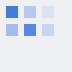

# 第 1 章 注意力

## 1.1 为什么需要注意力

Recurrent networks read a sentence one token at a time, so information from early tokens fades. Attention lets every position look directly at every other position; the ruler for "relevance" is learned.



## 1.2 自注意力

The Transformer uses scaled dot-product attention to compare queries with keys. Each score is divided by the square root of the key dimension, which keeps the softmax from saturating.

$$
\mathrm{Attention}(Q, K, V) = \mathrm{softmax}\left(\frac{QK^\top}{\sqrt{d_k}}\right) V
$$

```python
def attention(q, k, v):
    scores = q @ k.T / math.sqrt(k.shape[-1])
    return softmax(scores) @ v
```
